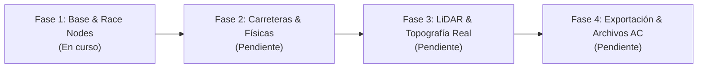

# Roadmap del Proyecto: Track Maker

Este documento define el estado actual, las fases de desarrollo planificadas y el registro de avances del proyecto. Cualquier agente de IA debe actualizar este archivo al completar hitos o redefinir prioridades.

---

## 🧭 Estado Actual del Proyecto
* **Fase Activa:** **Fase 1 (En implementación)**
* **Objetivo de la Fase:** Esqueleto modular del Addon de Blender 4.2+, paneles de interfaz de usuario y generador interactivo de Nodos de Carrera de Assetto Corsa (`AC_START_`, `AC_PIT_`, `AC_TIME_`, `AC_HOTLAP_`).

---

## 🗺️ Fases de Desarrollo

---

### Fase 1: Esqueleto Modular y Nodos de Carrera de Assetto Corsa 🟡 *(En Progreso)*
- [x] Documentación exhaustiva técnica y guía de handover para futuros agentes.
- [x] Definición de constantes oficiales de Assetto Corsa (`core/constants.py`).
- [ ] Creación de propiedades de escena y objeto (`core/properties.py`).
- [ ] Utilidades de escena: colecciones automáticas, visualizadores de orientación y flechas (`core/utils.py`).
- [ ] Operador de Parrilla de Salida (`race_nodes/spawn_manager.py`):
  - Creación de `AC_START_0..N`.
  - Opciones de espaciado longitudinal/lateral, escalonado (staggered) o en fila india.
  - Orientación automática siguiendo curvas o dirección del circuito.
- [ ] Operador de Puestos de Boxes (`AC_PIT_0..N`):
  - Creación de boxes con distancia configurable.
- [ ] Operador de Salida Lanzada / Hotlap (`AC_HOTLAP_START_0`).
- [ ] Operador de Puertas de Cronometraje (`race_nodes/timing_gates.py`):
  - Línea de Meta: `AC_TIME_0_L` y `AC_TIME_0_R`.
  - Splits / Sectores: `AC_TIME_1_L/R`, `AC_TIME_2_L/R`.
  - Modo Tramo A-B (Hillclimb/Rally): `AC_AB_START_L/R` y `AC_AB_FINISH_L/R`.
- [ ] Panel UI en el Sidebar (`3D View > N-Panel > Track Maker`).

---

### Fase 2: Carreteras Procedurales y Separación Física/Visual ⚪ *(Pendiente)*
- [ ] Generador de curvas guía de circuito (Spline 3D).
- [ ] Creación del grafo de **Geometry Nodes** para extrusión de calzada:
  - Anchura de pista configurable y peralte dinámico (*tilt*).
  - Generación de bordillos / banquetas / arcenes.
  - Generación de barreras / guardarraíles / muros (`1WALL_`).
- [ ] Generación automática y desacoplada de la **Malla Física (`1ROAD_`)**:
  - Subdivisión longitudinal uniforme (0.2m - 0.5m) optimizada para el FFB de Assetto Corsa.
  - Triangulación limpia sin artefactos.
- [ ] Mapeo UV procedural para la malla visual:
  - Textura de asfalto continua a lo largo del trazado sin deformaciones.
  - Canales UV auxiliares para líneas blancas y marcas de frenada.

---

### Fase 3: Integración de Datos Topográficos Reales (LiDAR / GIS) ⚪ *(Pendiente)*
- [ ] Sistema de Anclaje Georreferenciado (*Geo-Anchor*):
  - Compensación y desplazamiento del origen local `(0, 0, 0)` para neutralizar el *floating-point jitter* (pérdida de precisión de 32 bits).
- [ ] Módulo de proyección al terreno (*Terrain Snapping*):
  - Algoritmo de *Raycast / Surface Conform* mediante Geometry Nodes para adaptar la curva y el asfalto exactamente a la cota del terreno real.
  - Suavizado adaptativo de pendientes (*smoothing*) para evitar saltos irreales en nubes de puntos no depuradas.

---

### Fase 4: Validación Pre-flight, Exportación y Empaquetado ⚪ *(Pendiente)*
- [ ] Validador Pre-flight:
  - Verificación de existencia de nodos mínimos (`AC_START_0`, al menos una puerta de cronometraje).
  - Verificación de nombres de mallas físicas (`1ROAD_`, `1WALL_`, etc.).
  - Detección de solapamientos o escalas no uniformes (escala != 1.0).
- [ ] Exportador FBX para ksEditor:
  - Configuración automatizada de ejes (Z-Up, Y-Forward) y unidades métricas.
- [ ] Generador de configuración de pista:
  - `surfaces.ini` con valores predeterminados según materiales.
  - `models.ini` configurando los archivos `.kn5`.
  - `ui/ui_track.json` con metadatos del circuito (longitud calculada de spline, autor, país, curvas).
