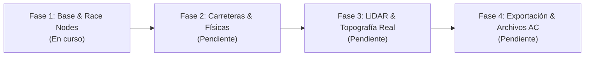

# Roadmap del Proyecto: Track Maker

Este documento define el estado actual, las fases de desarrollo planificadas y el registro de avances del proyecto. Cualquier agente de IA debe actualizar este archivo al completar hitos o redefinir prioridades.

---

## 🧭 Estado Actual del Proyecto
* **Fase Activa:** **Fase 4 (Siguiente: Validación Pre-flight, Exportación FBX y Empaquetado de Mod para Assetto Corsa)**
* **Hitos Recientes:** Fases 1, 2 y 3 completadas con éxito (Esqueleto modular, Race Nodes AC, Carreteras procedurales, Malla física 1ROAD_, Geo-Anchor anti-jitter, Snapping LiDAR Raycast y suite completa de tests).

---

## 🗺️ Fases de Desarrollo

---

### Fase 1: Esqueleto Modular y Nodos de Carrera de Assetto Corsa 🟢 *(Completada)*
- [x] Documentación exhaustiva técnica y guía de handover para futuros agentes.
- [x] Definición de constantes oficiales de Assetto Corsa (`core/constants.py`).
- [x] Creación de propiedades de escena y objeto (`core/properties.py`).
- [x] Utilidades de escena: colecciones automáticas, visualizadores de orientación y flechas (`core/utils.py`).
- [x] Operador de Parrilla de Salida (`race_nodes/spawn_manager.py`):
  - Creación de `AC_START_0..N`.
  - Opciones de espaciado longitudinal/lateral, escalonado (staggered), paralelo o en fila india.
  - Orientación automática y flecha visual en 3D Viewport.
- [x] Operador de Puestos de Boxes (`AC_PIT_0..N`):
  - Creación de boxes con distancia configurable.
- [x] Operador de Salida Lanzada / Hotlap (`AC_HOTLAP_START_0`).
- [x] Operador de Puertas de Cronometraje (`race_nodes/timing_gates.py`):
  - Línea de Meta: `AC_TIME_0_L` y `AC_TIME_0_R`.
  - Splits / Sectores: `AC_TIME_1_L/R`, `AC_TIME_2_L/R`.
  - Modo Tramo A-B (Hillclimb/Rally): `AC_AB_START_L/R` y `AC_AB_FINISH_L/R`.
- [x] Panel UI en el Sidebar (`3D View > N-Panel > Track Maker`):
  - `panel_main.py`: Diagnóstico de circuito y estado en tiempo real de nodos en escena.
  - `panel_race_nodes.py`: Controles interactivos y generación con 1 clic.

---

### Fase 2: Carreteras Procedurales y Separación Física/Visual 🟢 *(Completada)*
- [x] Generador de curvas guía de circuito (Spline 3D en `curve_tools.py`) para circuitos cerrados y tramos A-B.
- [x] Herramientas de peralte: Fijar peralte exacto (`set_curve_tilt`) y cálculo de auto-peralte por radio de curvatura (`auto_bank_curve`).
- [x] Generador de perfiles transversales paramétricos (`profile_generator.py`):
  - Calzada con anchura ajustable y bombeo parabólico de drenaje (*camber*).
  - Bordillos / pianos laterales con chaflán (`KERB`).
  - Banquetas peatonales urbanas (`SIDEWALK`).
  - Muros y barreras rígidas (`WALL`).
- [x] Árbol interactivo de **Geometry Nodes** para previsualización en tiempo real (`geometry_nodes.py`).
- [x] Generador de mallas acopladas/desacopladas (`road_generator.py`):
  - **Malla Visual (`ROAD_`)**: UV continuo longitudinal sin estiramiento (`UVMap`), materiales asignados (`MAT_TM_Asphalt`, `MAT_TM_Kerb`, `MAT_TM_Sidewalk`, `MAT_TM_Wall`) en `TM_Road_Visual`.
  - **Malla Física (`1ROAD_`)**: Subdivisión longitudinal uniforme (0.2m - 0.4m para FFB), triangulación obligatoria para el motor de físicas de AC en `TM_Road_Physics`.
- [x] Panel UI de carreteras (`ui/panel_road.py`) integrado en el N-Panel de Blender.
- [x] Tests unitarios matemáticos y de perfiles (`tests/test_road_profile.py`).

---

### Fase 3: Integración de Datos Topográficos Reales (LiDAR / GIS) 🟢 *(Completada)*
- [x] Sistema de Anclaje Georreferenciado (*Geo-Anchor* en `geo_anchor.py`):
  - Conversión de WGS84 (Lat/Lon) a UTM con cálculo de husos y hemisferio.
  - Compensación y desplazamiento del origen local `(0, 0, 0)` para neutralizar el *floating-point jitter* (pérdida de precisión de 32 bits).
  - Operador para recentrar mallas y nubes de puntos importadas (`recenter_gis_objects`).
- [x] Módulo de proyección al terreno (*Terrain Snapping* en `terrain_snap.py`):
  - Algoritmo de *Raycast Vertical* acelerado mediante árboles espaciales `BVHTree` para adaptar la curva Bézier a la topografía de la malla LiDAR (`snap_curve_to_terrain`).
  - Extracción y ajuste de peralte real (*Match Terrain Banking*) a partir de las normales de la superficie del terreno.
  - Filtro laplaciano de suavizado de pendientes (`smooth_curve_elevation`) para eliminar artefactos y ruido del escáner.
- [x] Panel UI de Topografía y LiDAR (`ui/panel_gis.py`) integrado en el N-Panel de Blender.
- [x] Tests unitarios de conversión de coordenadas y precisión milimétrica (`tests/test_geo_anchor.py`).

---

### Fase 4: Validación Pre-flight, Exportación y Empaquetado ⚪ *(Pendiente)*
- [ ] Validador Pre-flight:
  - Verificación de existencia de nodos mínimos (`AC_START_0`, al menos una puerta de cronometraje).
  - Verificación de nombres de mallas físicas (`1ROAD_`, `1WALL_`, etc.).
  - Detección de solapamientos o escalas no uniformes (escala != 1.0).
- [ ] Exportador FBX para ksEditor:
  - Configuración automatizada de ejes (Z-Up, Y-Forward) y unidades métricas.
- [ ] Generador de configuración de pista:
  - `surfaces.ini` con valores predeterminados según materiales.
  - `models.ini` configurando los archivos `.kn5`.
  - `ui/ui_track.json` con metadatos del circuito (longitud calculada de spline, autor, país, curvas).
