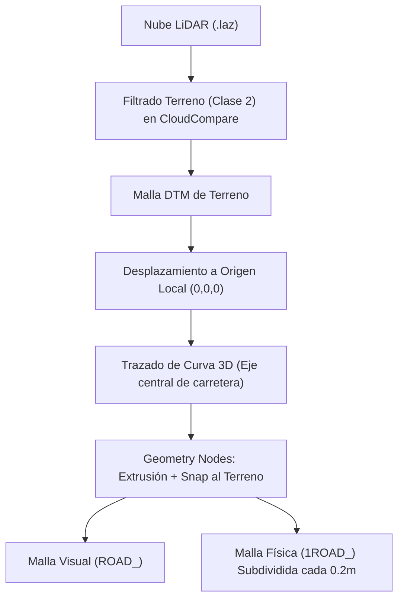

# Pipeline Geoespacial: Recreación de Circuitos con LiDAR y GIS

Este documento detalla el flujo de trabajo para capturar, procesar y utilizar datos geoespaciales del mundo real con el objetivo de construir carreteras y circuitos con fidelidad física y topográfica milimétrica en Blender y Assetto Corsa.

---

## 1. Fuentes de Datos Topográficos Abiertos

Para modelar carreteras reales con máxima precisión, la fuente fundamental son los escaneos aéreos **LiDAR** (nubes de puntos `.laz` / `.las`) o los **Modelos Digitales del Terreno (MDT / DTM)**:

| Región | Entidad / Portal | Resolución Típica | Formato |
| :--- | :--- | :--- | :--- |
| **España** | [IGN / Centro de Descargas CNIG](https://centrodedescargas.cnig.es/) | 0.5 - 1 punto/m² | LAZ / DTM GeoTIFF |
| **Estados Unidos** | [USGS 3DEP](https://apps.nationalmap.gov/downloader/) | 1m - 0.25m | LAZ / GeoTIFF |
| **Reino Unido** | [DEFRA Open Data](https://environment.data.gov.uk/) | 1m - 0.25m | LAZ / GeoTIFF |
| **México** | [INEGI / MDE](https://www.inegi.org.mx/) | 5m - 15m DTM | Bil / GeoTIFF |
| **Global** | [OpenTopography](https://opentopography.org/) | Variable | LAZ / DEM |

---

## 2. El Problema Crítico del "Floating-Point Jitter"

### ¿Qué ocurre?
Las coordenadas geográficas proyectadas (como UTM WGS84) trabajan con números gigantescos:
* Coordenada X (Easting): `~450,000.0` metros.
* Coordenada Y (Northing): `~4,200,000.0` metros.

Tanto Blender como los motores de videojuegos (incluido el motor DirectX 11 de Assetto Corsa) utilizan **números en coma flotante de precisión simple (32 bits / `float32`)** para calcular la posición de los vértices y la cámara.

Cuando las coordenadas son de millones de metros, la precisión disponible para los decimales (milímetros y centímetros) se pierde. El resultado es:
* **Vertex Jittering:** Los vértices de la carretera tiemblan visiblemente al moverse la cámara o el coche.
* **Z-Fighting:** Parpadeo continuo de texturas superpuestas.
* **Físicas inestables:** El coche recibe sacudidas y fuerzas FFB fantasmas causadas por el redondeo numérico.

### Solución Arquitectónica: Ancla Georreferenciada (Geo-Anchor)
Track Maker implementa un sistema de compensación de coordenadas:
1. Se define un punto central del circuito en coordenadas geográficas reales: `Anchor(UTM_X, UTM_Y, Elevation_Z)`.
2. Todos los datos importados (LiDAR, curvas, mallas) se trasladan restando el ancla:
   $$\vec{P}_{local} = \vec{P}_{real} - \vec{P}_{anchor}$$
3. El centro de la pista queda exactamente en `(0, 0, 0)` en Blender.
4. Las unidades se mantienen en metros: $1\text{ Blender Unit} = 1.0\text{ metro real}$.

---

## 3. Procesamiento de Nubes de Puntos (LiDAR)

1. **Filtrado de Vegetación y Ruido (Ground Classification):**
   * Las nubes de puntos crudas contienen árboles, cables y coches.
   * Utilizar **CloudCompare** o herramientas de línea de comandos como **PDAL** para filtrar la nube quedándose únicamente con la **Clase 2 (Ground / Terreno)** según el estándar ASPRS.
2. **Generación de Malla de Terreno DTM:**
   * Mediante triangulación (Poisson Recon o Delaunay 2.5D), se genera una malla optimizada del terreno.
   * La malla de terreno resultante sirve como base de colisión secundaria (`1GRASS_`, `1SAND_`) y como referencia de altura (*snap target*) para la carretera.

---

## 4. Trazado de Curva y Proyección de Calzada

1. **Spline Central:**
   * Se traza una curva Bézier siguiendo la línea central de la carretera sobre la ortofoto o la nube de puntos.
2. **Peralte y Pendiente:**
   * La curva captura la pendiente real y mediante la herramienta de peralte (*Tilt*) se ajusta la inclinación transversal de las curvas.
3. **Raycast / Snapping:**
   * El generador de Geometry Nodes proyecta hacia abajo los puntos del perfil transversal para copiar las irregularidades exactas del asfalto real.
